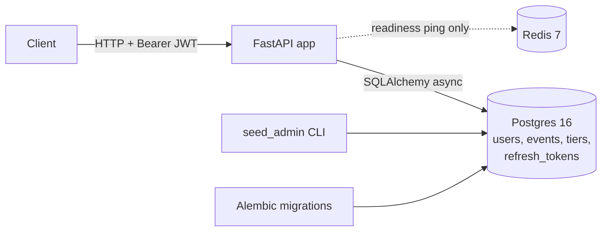

# seatsurge

[](https://github.com/deepta001/seatsurge/actions/workflows/ci.yml)

A ticket booking backend designed to stay correct when thousands of people
try to buy the same limited seats at once.

> **Status: Phase A complete** (accounts and events). The never-oversell
> booking engine (Redis holds, orders, outbox, worker) is the next phase and
> is **not built yet**. This README only lists features that a test
> demonstrates.

## What works today

| Feature | Endpoints | Proven by |
|---|---|---|
| Health checks | `GET /health/live`, `GET /health/ready` (503 if Postgres or Redis is down) | `tests/unit/test_health.py` |
| Sign-up, always as `USER`; argon2 password hashes; duplicates are a 409 decided by DB UNIQUE constraints | `POST /auth/register` | `tests/integration/test_register.py`, adversarial test 15 |
| Login with 15-minute HS256 JWT access tokens; identical 401 for "wrong password" and "no such email" | `POST /auth/login`, `GET /me` | `tests/unit/test_tokens.py`, `tests/integration/test_login.py` |
| Auth on protected routes reads the token only (no DB query) | `GET /me` | `tests/unit/test_me.py` (passes with the DB unreachable) |
| Rotating single-use refresh tokens, stored as SHA-256 hashes, with reuse detection that revokes the whole login family; real logout | `POST /auth/refresh`, `POST /auth/logout` | `tests/integration/test_refresh.py` |
| Admins created only from the CLI (no default credentials) | `scripts/seed_admin.py` | `tests/unit/test_seed_admin.py` |
| Admin event management: create with tiers, one-way status DRAFT -> PUBLISHED -> CANCELLED, delete drafts only; 403 for non-admins | `POST/PATCH/DELETE /events` | `tests/integration/test_events_admin.py` |
| Public browsing: upcoming published events, name search (wildcards escaped), city filter, capped paging; drafts are 404 | `GET /events`, `GET /events/{id}` | `tests/integration/test_events_public.py` |
| Database rules as the source of truth: `0 <= sold <= capacity`, unique tier names, role and status CHECKs | Alembic migrations | `tests/unit/test_models.py`, CI migration checks |
| **Confirm (Phase C, in progress):** pay for your hold (mock payment tokens) and get a PENDING order; the order and its outbox row are written in one transaction; quantity comes from the hold and price from the database; forged or foreign holds get 404; on any failure the hold is given back and a payment is refunded; per-user purchase cap of 10 per event | `POST /holds/{id}/confirm` | `tests/integration/test_confirm_api.py`, adversarial tests 2 and 3 |
| **Outbox relay (Phase C, in progress):** the worker publishes committed outbox rows to the `stream:orders` Redis Stream, oldest first; several relays at once never publish a row twice (`FOR UPDATE SKIP LOCKED`); one failing row doesn't block the rest (it backs off 1 s, 2 s, 4 s ... and goes DEAD after 8 attempts, or at once if it can never be published; a Redis outage costs no attempts); published rows are deleted after 24 h. Tickets are not issued yet | `python -m app.worker.main` | `tests/integration/test_outbox_relay.py`, adversarial test 8 |
| **Stream consumer (Phase C, in progress; ):** reads `stream:orders` as the consumer group `order-workers`, so each message goes to one worker; acks only after its handler succeeds; failures stay pending without blocking the batch; nothing published before the group existed is missed | `app/worker/consumer.py` | `tests/integration/test_stream_consumer.py` |
| **Duplicates are harmless (test 7):** each message's outbox id is recorded in `processed_messages` in the same transaction as the handler's work, so a duplicate (even arriving at two workers at once) is skipped, and a failed attempt leaves nothing behind | `app/worker/idempotency.py` | adversarial test 7 |
| **Tickets are issued (Phase C):** the worker turns each PENDING order into numbered tickets and marks it CONFIRMED (about 0.5 s after confirm in a live run); one conditional `UPDATE ... WHERE sold + q <= capacity RETURNING next_number` means even with Redis wiped or wrong no more tickets than seats are issued (60 orders on 50 seats: exactly 50); the Redis hold becomes CONSUMED after the commit | `python -m app.worker.main` | adversarial test 4, `tests/integration/test_issue_tickets.py` |
| **Failures never leak seats (test 9):** failed messages are retried with backoff (1 s, 2 s, 4 s ...); a crashed worker's messages are taken over by another; after 5 failed deliveries, or at once when retrying can't help (e.g. the database backstop refused), the message goes to `stream:orders:dead`, the order becomes FAILED and its seats go back on sale; an order that already has tickets is never released | `python -m app.worker.main` | adversarial tests 9 and 4 |
| **Relay crashes lose nothing (test 10):** an order committed while the relay is down, or a relay killed right after publishing (before marking the row), or one whose database connection dies while holding row locks: in every case the order is delivered and gets its tickets exactly once | outbox relay | adversarial test 10 |
| **Reconcile (Phase D):** an admin rebuilds an event's Redis seat counters from Postgres and live holds, fixing drift (shows before and after); holds pause briefly while each counter is rebuilt, so reconciling mid-sale never oversells | `POST /admin/events/{id}/reconcile` | `tests/integration/test_reconcile.py` |
| **Redis flushed mid-sale (test 11):** no oversell (counters rebuilt from Postgres: 56 rush requests won exactly the 39 seats really left); the worker re-creates its consumer group by itself; reconcile re-sends PENDING orders whose messages were wiped; the sale then completes with exactly 50 tickets for 50 seats | Redis flush recovery | adversarial test 11 |
| **Cancel (test 13):** cancel your confirmed order; tickets and order become CANCELLED and `sold` drops in one transaction; the worker then puts the seats back on sale exactly once; ticket numbers are never reused (a re-buy gets new numbers); repeated or simultaneous cancels change nothing | `POST /orders/{id}/cancel` | adversarial test 13 |
| **Reserved seating, data and seat map (Phase D, in progress):** a reserved-seating event gets one labelled seat per unit of capacity (at most 5,000); the public seat map shows each seat as AVAILABLE, HELD or SOLD, compact by default, with labels on request. Holding and buying specific seats: see below | `GET /events/{id}/seats` | `tests/integration/test_seat_map.py` |
| **Holding specific seats (Phase D, in progress):** choose up to 10 seats in one tier; all are held or none (`seat_taken`), even with 60 buyers racing for 8 seats; a sold seat is never held again, even after Redis forgets which seats are sold; cancel and expiry free the seats. Then confirm buys them like any hold | `POST /events/{id}/holds` with `seat_ids` | `tests/integration/test_seat_holds.py` |
| **Buying reserved seats:** confirmed seat holds become one ticket per seat; a seat can never get two live tickets (Postgres partial unique index), even if Redis let two orders through; cancelling puts the seats back on sale (new ticket numbers next time); seats of PENDING orders stay protected after a Redis flush; a failed order frees its seats but never a seat someone else bought | confirm, cancel, worker | `tests/integration/test_seat_purchase.py` |
| **Seats never sold twice (test 4b):** 40 buyers racing for 12 seats through hold, confirm and the worker: no seat with two live tickets, and Redis, Postgres and the seat map agree; with Redis wiped, 20 orders for one seat give exactly 1 ticket; an expired hold's seat goes to the next buyer only | reserved seating | adversarial test 4b |
| **Rate limiting (test 14):** holds 20 per user and logins 5 per email and 20 per IP, per sliding 60 s window (configurable); 429 with Retry-After; atomic (40 simultaneous requests at a limit of 10 let exactly 10 through); login keeps working if Redis is down | holds, `POST /auth/login` | adversarial test 14 |
| **Security checklist (S7.2):** every section-9 item audited in `docs/security-checklist.md`; CORS allowlist; refuses to start with placeholder secrets; errors never echo input or internals (500s carry a correlation id); API docs off in production; the route list is pinned so no debug endpoint can slip in | all routes | `tests/integration/test_security_hardening.py` |
| **Live availability (S7.3):** SSE stream per event, fed by the worker through Redis pub/sub (so any API process can serve it; multi-replica is checked in S8.1); changes coalesced to at most 5 updates/s per event, each a fresh snapshot; one Redis subscription per process; an open stream holds no DB connection | `GET /events/{id}/stream` | `tests/integration/test_live_updates.py` |
| **Three replicas behind nginx (S8.1):** one image for api and worker, non-root containers; migrations run once before anything starts; nginx round robin (9 requests -> 3/3/3; 1,000 buyers -> 334/334/333 with exactly 100 holds and 0 oversold); live updates reach viewers on every replica; clients can't fake their IP past the per-IP login limit; `/metrics` not routed | `docker compose up`, port 8080 | `tests/unit/test_deploy_config.py` + `learning/examples/s8_1/` (live checks) |
| **Metrics and dashboard (S8.2):** Prometheus scrapes every api replica and the worker: request latency by route template, holds created/rejected by reason, orders placed/confirmed/failed (counted once, after commit), dead letters, hold expiries, outbox and stream backlog, Redis script latency, and `invariant_violations_total`, which every test asserts stays 0 unless it trips a backstop on purpose. Grafana dashboard provisioned from `deploy/grafana/`; both bound to 127.0.0.1, Grafana password from `.env`; `/metrics` not routed by nginx | Prometheus :9090, Grafana :3000 | `tests/integration/test_metrics.py` + the autouse guard in `tests/conftest.py` |
| **Structured logs, traceable end to end (S8.2b):** one JSON object per log line; every request gets a correlation id (nginx's `$request_id`, or a fresh one; unsafe incoming ids are replaced), returned in `X-Correlation-ID`, written on every log line and access line, stored on the outbox row, and carried through the stream to the worker's log lines | all routes, relay, worker | `tests/integration/test_correlation.py`, `tests/unit/test_log_setup.py`; live: `learning/examples/s8_2b/trace_a_purchase.py` |
| **Never oversell (test 1):** 500 concurrent HTTP buyers wanting 1-4 seats on 50 seats never take more than 50 (also with the counter rebuilt mid-rush); the test fails if the atomic script is swapped for naive check-then-take. A demo with 3 API processes on the dev stack: 1,000 buyers / 100 seats gave exactly 100 holds | `POST /events/{id}/holds` | `tests/concurrency/test_01_concurrent_holds_never_oversell.py` |
| **Holds:** reserve 1-10 seats for 5 minutes via one atomic Redis Lua script; 409 sold_out or hold_limit_exceeded (10 per user per event); a missing counter is a 503, never zero. 300 simultaneous HTTP requests on 50 seats give exactly 50 holds | `POST /events/{id}/holds` | `tests/integration/test_holds_api.py`, `tests/integration/test_reserve_tier.py` |
| A missing Redis counter is rebuilt from Postgres + active holds (one rebuild at a time, even for 50 simultaneous requests), never treated as zero; 503 only if the rebuild can't finish | automatic in `POST /events/{id}/holds` | adversarial test 12 |
| Releasing: a user can cancel their own hold; a worker sweeper returns expired holds' seats (within about 1 s of expiry); every release is idempotent (never returns seats twice, even when racing) | `DELETE /holds/{id}`, `python -m app.worker.main` | adversarial test 5, `tests/integration/test_release_hold.py`, `tests/integration/test_cancel_hold_api.py` |
| Limits: 1-10 seats per hold; at most 10 held per user per event, even with many simultaneous requests; request bodies over 16 KB get 413 before being read | middleware + `reserve_tier.lua` | `tests/concurrency/test_user_hold_cap.py`, `tests/unit/test_body_limit.py` |
| Safe retries: a required `Idempotency-Key`; the same key replays the first answer (one hold, even for 10 simultaneous retries); the same key with a different body is a 422 | `Idempotency-Key` header | adversarial test 6 |

The 305 tests (55 unit, 172 integration, 7 concurrency, 71 adversarial) run
against a real Postgres 16 and Redis 7 started by testcontainers. CI also applies every migration to an
empty database, runs `alembic check` for model drift, and proves the
downgrade path.

## Architecture so far (Phase A)



## Where it's going (the full design)

```
client -> nginx -> api (x3) --Lua--> Redis (holds, counters)
                      |
                      +--txn--> Postgres (orders + outbox_events)
                                     |
                         relay (SKIP LOCKED) --XADD--> Redis Stream
                                                           |
                                         worker (consumer group, idempotent)
                                                           |
                       Postgres (tickets, tier sold counters) + pub/sub -> SSE
```

Redis will be the fast gate (atomic Lua scripts, expiring holds); Postgres
stays the source of truth, with constraints that make overselling impossible
even if Redis is wrong. See `docs/design.md` for every decision and its
trade-offs, and `docs/failure-modes.md` for each failure and the test that
covers it.

## Run it locally

Needs Python 3.12, [uv](https://docs.astral.sh/uv/), Git and Docker Desktop.

```
cp .env.example .env                    # then replace every CHANGE_ME
uv sync
docker compose up -d --wait postgres redis   # only the databases, for local dev
uv run python -m alembic upgrade head   # create or update the tables
uv run python -m scripts.seed_admin --email you@example.com --username you
uv run python -m uvicorn app.main:app --reload
```

Then open http://127.0.0.1:8000/docs, log in, click **Authorize**, and paste
the access token.

### The whole system in Docker (S8.1)

```
docker compose up -d --build --wait     # Postgres, Redis, migrations, 3 api, worker, nginx
docker compose exec api python -m scripts.seed_admin --email you@example.com --username you
```

The API is then at http://127.0.0.1:8080 (nginx, round robin over 3 api
replicas). Prometheus is at http://127.0.0.1:9090 and Grafana at
http://127.0.0.1:3000 (user `admin`, password `GRAFANA_ADMIN_PASSWORD` from
`.env`; the **seatsurge** dashboard is preloaded). The replicas have no port of their own. Stop with
`docker compose down` (add `-v` to also delete the database volume).

Checks (Docker must be running for the tests):

```
uv run python -m pytest -v
uv run python -m ruff check .
uv run python -m ruff format --check .
uv run python -m mypy
uv run python -m alembic check
```

On Windows, run tools as `python -m <tool>`: Smart App Control blocks the
unsigned `.exe` launchers in `.venv\Scripts`.

## Repository layout

| Folder | What goes in it |
|---|---|
| `app/api/` | HTTP routes, request/response models, dependencies, error handlers |
| `app/core/` | Settings, password hashing, JWT tokens, typed errors |
| `app/db/` | Table models and sessions |
| `app/redis/` | Redis client (Lua scripts arrive in Phase B) |
| `app/services/` | Business logic: auth, refresh tokens, events |
| `app/worker/` | Background tasks (Phase C) |
| `migrations/` | Alembic migrations |
| `scripts/` | `seed_admin.py`, `check_connections.py` |
| `tests/` | `unit/`, `integration/`, `adversarial/` (and `concurrency/` from Phase B) |
| `docs/` | `design.md`, `failure-modes.md`, `glossary.md`, `learning-log.md` |
| `learning/` | Concept primers and runnable examples |

## Known limitations (Phase A)

- Access tokens can't be revoked early: a deleted or demoted user keeps
  access for up to 15 minutes (the stateless-auth trade-off).
- Old refresh-token rows aren't cleaned up yet.
- Admins can't list draft events through the API; tiers can't be edited
  after creation.
- Name search scans the table (fine for a small catalogue; no search index).

## Out of scope

Kafka, a front-end app, microservices, real payments and Kubernetes.
