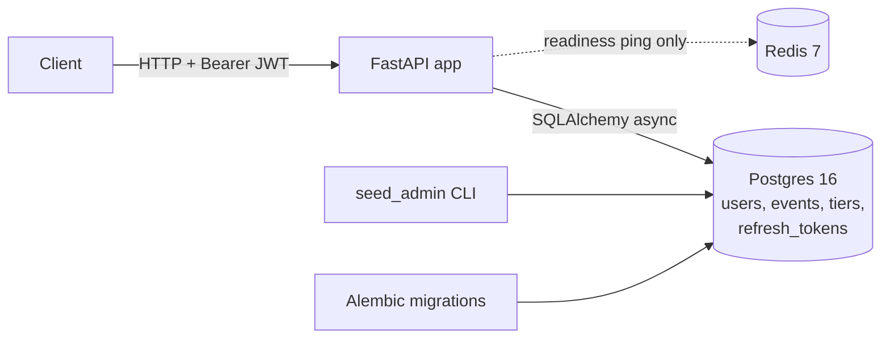

# seatsurge

[](https://github.com/deepta001/seatsurge/actions/workflows/ci.yml)

A ticket booking backend designed to stay correct when thousands of people
try to buy the same limited seats at once.

> **Status: Phase A complete** (accounts and events). The never-oversell
> booking engine (Redis holds, orders, outbox, worker) is the next phase and
> is **not built yet**. This README only lists features that a test
> demonstrates.

## What works today

| Feature | Endpoints | Proven by |
|---|---|---|
| Health checks | `GET /health/live`, `GET /health/ready` (503 if Postgres or Redis is down) | `tests/unit/test_health.py` |
| Sign-up, always as `USER`; argon2 password hashes; duplicates are a 409 decided by DB UNIQUE constraints | `POST /auth/register` | `tests/integration/test_register.py`, adversarial test 15 |
| Login with 15-minute HS256 JWT access tokens; identical 401 for "wrong password" and "no such email" | `POST /auth/login`, `GET /me` | `tests/unit/test_tokens.py`, `tests/integration/test_login.py` |
| Auth on protected routes reads the token only (no DB query) | `GET /me` | `tests/unit/test_me.py` (passes with the DB unreachable) |
| Rotating single-use refresh tokens, stored as SHA-256 hashes, with reuse detection that revokes the whole login family; real logout | `POST /auth/refresh`, `POST /auth/logout` | `tests/integration/test_refresh.py` |
| Admins created only from the CLI (no default credentials) | `scripts/seed_admin.py` | `tests/unit/test_seed_admin.py` |
| Admin event management: create with tiers, one-way status DRAFT -> PUBLISHED -> CANCELLED, delete drafts only; 403 for non-admins | `POST/PATCH/DELETE /events` | `tests/integration/test_events_admin.py` |
| Public browsing: upcoming published events, name search (wildcards escaped), city filter, capped paging; drafts are 404 | `GET /events`, `GET /events/{id}` | `tests/integration/test_events_public.py` |
| Database rules as the source of truth: `0 <= sold <= capacity`, unique tier names, role and status CHECKs | Alembic migrations | `tests/unit/test_models.py`, CI migration checks |
| **Holds (Phase B, in progress):** reserve 1-10 seats for 5 minutes via one atomic Redis Lua script; 409 sold_out or hold_limit_exceeded (10 per user per event); a missing counter is a 503, never zero. 300 simultaneous HTTP requests on 50 seats give exactly 50 holds | `POST /events/{id}/holds` | `tests/integration/test_holds_api.py`, `tests/integration/test_reserve_tier.py` |

The 84 tests (31 unit, 49 integration, 4 adversarial) run against a real
Postgres 16 started by testcontainers. CI also applies every migration to an
empty database, runs `alembic check` for model drift, and proves the
downgrade path.

## Architecture so far (Phase A)



## Where it's going (the full design)

```
client -> nginx -> api (x3) --Lua--> Redis (holds, counters)
                      |
                      +--txn--> Postgres (orders + outbox_events)
                                     |
                         relay (SKIP LOCKED) --XADD--> Redis Stream
                                                           |
                                         worker (consumer group, idempotent)
                                                           |
                       Postgres (tickets, tier sold counters) + pub/sub -> SSE
```

Redis will be the fast gate (atomic Lua scripts, expiring holds); Postgres
stays the source of truth, with constraints that make overselling impossible
even if Redis is wrong. See `docs/design.md` for every decision and its
trade-offs, and `docs/failure-modes.md` for each failure and the test that
covers it.

## Run it locally

Needs Python 3.12, [uv](https://docs.astral.sh/uv/), Git and Docker Desktop.

```
cp .env.example .env                    # then replace every CHANGE_ME
uv sync
docker compose up -d --wait             # Postgres 16 + Redis 7
uv run python -m alembic upgrade head   # create or update the tables
uv run python -m scripts.seed_admin --email you@example.com --username you
uv run python -m uvicorn app.main:app --reload
```

Then open http://127.0.0.1:8000/docs, log in, click **Authorize**, and paste
the access token.

Checks (Docker must be running for the tests):

```
uv run python -m pytest -v
uv run python -m ruff check .
uv run python -m ruff format --check .
uv run python -m mypy
uv run python -m alembic check
```

On Windows, run tools as `python -m <tool>`: Smart App Control blocks the
unsigned `.exe` launchers in `.venv\Scripts`.

## Repository layout

| Folder | What goes in it |
|---|---|
| `app/api/` | HTTP routes, request/response models, dependencies, error handlers |
| `app/core/` | Settings, password hashing, JWT tokens, typed errors |
| `app/db/` | Table models and sessions |
| `app/redis/` | Redis client (Lua scripts arrive in Phase B) |
| `app/services/` | Business logic: auth, refresh tokens, events |
| `app/worker/` | Background tasks (Phase C) |
| `migrations/` | Alembic migrations |
| `scripts/` | `seed_admin.py`, `check_connections.py` |
| `tests/` | `unit/`, `integration/`, `adversarial/` (and `concurrency/` from Phase B) |
| `docs/` | `design.md`, `failure-modes.md`, `glossary.md`, `learning-log.md` |
| `learning/` | Concept primers and runnable examples |

## Known limitations (Phase A)

- No rate limiting on login yet (planned in S7.1).
- Access tokens can't be revoked early: a deleted or demoted user keeps
  access for up to 15 minutes (the stateless-auth trade-off).
- Old refresh-token rows aren't cleaned up yet.
- Admins can't list draft events through the API; tiers can't be edited
  after creation.
- Name search scans the table (fine for a small catalogue; no search index).

## Out of scope

Kafka, a front-end app, microservices, real payments and Kubernetes.
